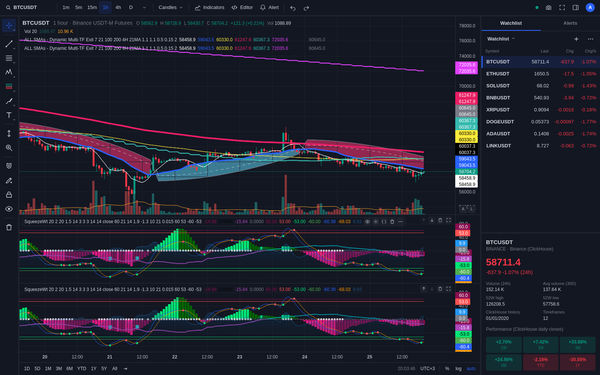

# Charting

A self-hosted, multi-tenant, TradingView-style charting platform built on
[lightweight-charts](https://github.com/tradingview/lightweight-charts) with ClickHouse as the history
store and Binance as the live feed.

- **Charts**: 12 timeframes (1m … 1M), 15 chart types (candles, hollow, volume candles, bars, line,
  step line, area, HLC area, baseline, columns, high-low, Heikin Ashi, Renko, Line break …),
  ~90 time zones, log / percent / auto scale, panes for oscillators; chart settings for candle
  body / border / wick colors, line color, background and grid (saved per user); TradingView-style
  pane controls (move up/down, also above the price pane, delete, collapse, maximize) with their own
  auto / log scale; "scroll to the most recent bar" button (Alt+Shift+→); changing the timeframe keeps
  the date on screen; **Go to** (calendar button in the bottom bar, `Alt+G`): a date or a custom range;
  phone layout (portrait and landscape): bottom tabs Chart / Watchlist / Alerts / Draw, a ☰ menu for the
  rest, drawing tools in a bottom sheet with a small tool bar while drawing, one-line legends.
- **Data**: live bars from one exchange REST call per selection plus one multiplexed websocket;
  older history is loaded from ClickHouse on scroll ("No data on ClickHouse" when there is none).
- **Drawing tools**: every TradingView tool family except AI and icons — trend lines, channels,
  pitchforks, Fibonacci & Gann tools, harmonic / Elliott patterns, forecasting & measurement
  (positions, anchored VWAP, volume profiles), shapes and annotations (≈80 tools).
- **Indicators**: 22 built-ins and user-written **custom indicators** in ChartScript
  (JavaScript with a Pine-like API, `security()` for multi-timeframe, `fill()`, `plotshape()`),
  edited in an in-browser editor and executed in a sandbox.
- **Screener**: filters on the backtest engine's indicators on any timeframe (also other timeframes in one
  screen), columns, the symbol's regime, 24h stats; saved screens; **screener alerts** for new matches.
- **Strategy tester**: long / short entries, stop and take profit (% or ATR), on one symbol, a watchlist or the
  screener results; metrics and trades on the chart. **Paper trading**: several strategies at once, forward on
  closed bars on the server, with create / edit / pause / restart / delete. See [docs/SCREENER.md](docs/SCREENER.md).
- **Alerts**: price, drawing, indicator and screener alerts (including custom indicators) evaluated on the
  server — notifications arrive even when the browser is closed: in-app, Telegram, e-mail, webhook.
- **Multi-tenant**: everything (layout, drawings, watchlists, scripts, alerts) is stored per user.
  Pluggable authentication (local, auth-proxy header, ready for IAM/OIDC) and subscription plans
  with limits enforced by the server and the alert engine.
- **Admin UI**: ClickHouse data sources (host, credentials, database and table mapping), users,
  plans, notification servers.



## Quick start (Docker)

```bash
cp .env.example .env          # set CH_URL / CH_USER / CH_PASSWORD of the ClickHouse server
docker compose up -d --build  # http://<host>:8080
docker compose exec backend python3 server.py adduser admin --admin   # create the first admin
```

The backend creates the `charting` database and its tables on start, and registers the existing
`backtest_*_klines` tables as the `BINANCE` data source the first time it runs. Further data sources
are added in the UI: **user menu → Data Sources (ClickHouse)**.

Containers: `frontend` (nginx, port 8080), `backend` (Python 3.15 API, alert and paper-trading engines),
`jsworker` (Node 26, runs indicator code for server-side alerts with no network at all; see
[docs/SECURITY.md](docs/SECURITY.md)) and `backtester` (Python 3.13 with numpy / numba / TA-Lib: the backtest
engine for the screener, strategy tester and paper trading; internal only).

## Running without Docker

Requirements: Python ≥ 3.11 and Node ≥ 20, Node ≥ 25 recommended (for the server-side indicator sandbox; from 25 Node's permission model also blocks network access). No pip / npm
packages are needed for the app itself. The screener, tester and paper trading need the backtester
(`pip install -r backtester/requirements.txt`, then `cd backtester && python3 server.py`, port 8090;
the backend finds it at `BACKTESTER_URL`, default `http://127.0.0.1:8090`).

```bash
cp .env.example .env
python3 server.py adduser admin --admin
python3 server.py            # http://localhost:8080
```

## Documentation

| Document | Contents |
| --- | --- |
| [docs/ARCHITECTURE.md](docs/ARCHITECTURE.md) | Components, data flow, ClickHouse schema, API |
| [docs/CHARTSCRIPT.md](docs/CHARTSCRIPT.md) | Custom indicator summary; the full reference is the in-app page [static/docs/chartscript.html](static/docs/chartscript.html) (**Docs** in the editor) |
| [docs/SCREENER.md](docs/SCREENER.md) | Screener, strategy tester, paper trading, the backtester service |
| [docs/ALERTS.md](docs/ALERTS.md) | Alert engine, conditions, notifications, exchange rate limits |
| [docs/ADMIN.md](docs/ADMIN.md) | Data sources, users, subscription plans, notification servers |
| [docs/SECURITY.md](docs/SECURITY.md) | Authentication, tenancy, sandboxing of user code, IAM migration |
| [docs/TESTING.md](docs/TESTING.md) | Test cases and how to run the Playwright suite |

## Repository layout

```
server.py                HTTP server, API routes, CLI (adduser / passwd / users)
backend/                 auth, ClickHouse client, market data, alerts engine, plans, notifications,
                         live exchange client, sandboxed JS runner (jsrunner.py + jsworker.js)
static/                  the web app (no build step): index.html, css/, js/, vendor/
backtester/               backtest engine (backtestengine/) and its HTTP service (server.py, bt/)
sql/schema.sql           ClickHouse schema (applied automatically)
examples/                ChartScript ports of Pine indicators (SqueezeWt, ALL SMAs)
docker/, docker-compose.yml
tests/e2e/               Playwright end-to-end tests
```
